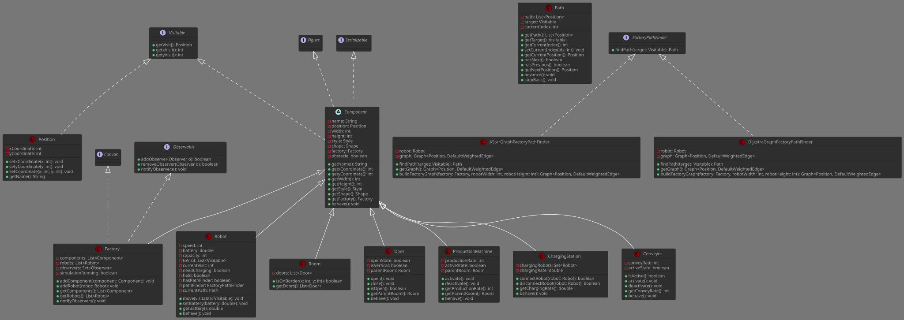
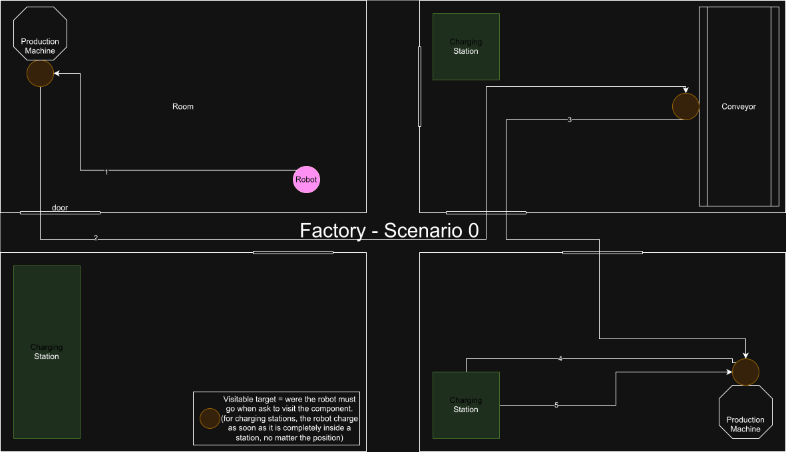
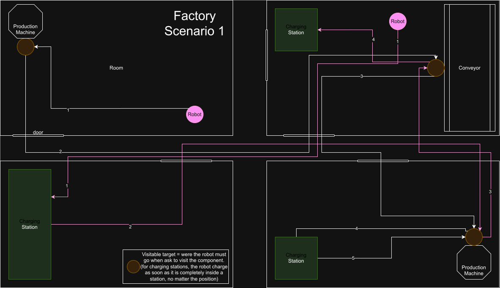
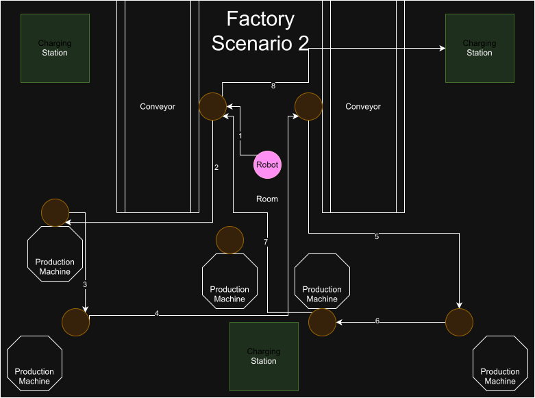

# INF112 - Usine Projet JAVA

Projet réalisé pour le cours INF112 de Télécom Paris. Il simule une usine dont des robots. Ces robots se mouvoient de manière autonome en suivant une liste de visite définie à l'avance dans l'usine grâce à la programmation orientée objet. 

> team-55 - Etienne DEBACQ, Alban DE LA ROCHEFOUCAULD & Marius ALBERT.

## Table des matières

- [Objectifs du projet](#objectifs-du-projet)
- [Organisation du projet](#organisation-du-projet)
- [Documentation](#documentation)
- [Compilation](#compilation)
  - [Options](#options)
    - [Compilation Spécifique](#compilation-spécifique)
    - [Compilation Documentation](#compilation-documentation)
    - [Nettoyage Compilation](#nettoyage-compilation)
- [Lancement de la simulation](#lancement-de-la-simulation)
  - [Options](#options-1)
  - [Scénarios](#scénarios)
    - [Scénario 0](#scénario-0)
    - [Scénario 1](#scénario-1)
    - [Scénario 2](#scénario-2)
- [Logging](#logging)
- [Utilisateurs Eclipse](#utilisateurs-eclipse)
  - [Fichiers de configuration Eclipse](#fichiers-de-configuration-eclipse)
  - [Importation et lancement de la simulation](#importation-et-lancement-de-la-simulation)

***


## Objectifs du projet

- [x] Modéliser une usine de production robotique simplifiée contenant les éléments suivants :
  - [x] Usine
  - [x] Robots
  - [x] Stations de recharge pour robots
  - [x] Salles et portes
  - [x] Machines de production
  - [x] Convoyeurs

- [x] Simuler le comportement des robots transportant des biens produits d'un endroit à un autre dans l'usine :
  - [x] Pour chaque robot, fournir une liste de positions à visiter dans l'usine, et le robot doit se déplacer pour les visiter successivement.
  - [x] Les robots doivent éviter les obstacles sur leur chemin.
  - [x] Simuler la consommation d'énergie des robots.
  - [x] Si un robot atteint un niveau d'énergie minimum spécifié (dans notre cas 0), il doit se déplacer vers une station de recharge et y rester un certain temps pour se recharger.
  - [x] Le robot doit pouvoir se déplacer en diagonnale.
  - [x] Les portes s'ouvrent et se ferment automatiquement à l'approche des robots.

- [x] L'usine et sa simulation doivent être visualisées via une interface graphique.

- [x] Le modèle (données) doit être sauvegardable sur disque.

- [x] L'application doit gérer les exceptions IO pouvant survenir pendant l'exécution du programme.

- [x] Implémenter les bonnes pratiques de programmation discutées en cours :
  - [x] Définition et organisation des classes.
  - [x] Conventions de nommage.
  - [x] Commentaires et formatage du code.

- [x] L'architecture doit suivre le modèle MVC.


## Organisation du projet

Le diagramme suivant illustre l'architecture du modèle de notre projet (les attributs et les méthodes).



Pour une documentation plus complète, voir [ici](#documentation)


## Documentation

Une documentation du projet est disponible [ici](./javadoc/index.html). Cette documentation est générée/compilée automatiquement en utilisant le programme `javadoc` (généralement disponible avec toute installation de Java JDK). Il est possible de vouloir la re-compiler, pour ce faire voir la section [compilation documentation](#compilation-documentation).


## Compilation

Afin de compiler le programme, assurez-vous d'être dans le répertoire "root" du projet.

> [!IMPORTANT]
> Le projet a été compilé en utilisant [OpenJDK 23](https://openjdk.org/projects/jdk/23/) et [OpenJDK 24](https://openjdk.org/projects/jdk/24/).

Ensuite lancez simplement le script :

```bash
./build.sh
```

### Options

#### Compilation Spécifique

Il est possible de ne vouloir compiler qu'un seul project à la fois (attention, aucune inter-dépendance n'est gérer automatiquement dans ce cas), il est possible de le faire en ajoutant le nom du projet en argument :

```bash
./build.sh [project_name]
```


#### Compilation Documentation

Il est possible de vouloir re-compiler une documentation (générée automatiquement par `javadoc`), pour ce faire il faut exécuter la commande suivante :

```bash
./build.sh -d
```

> [!IMPORTANT]
> Un fichier *javadoc_build.log* sera généré automatiquement avec les informations de la compilation, il sera placé dans le dossier [config](./config).

#### Nettoyage Compilation

Si vous voulez supprimer les fichiers produits par la compilation, ajouter l'argument `-c` lors de l'exécution du script :

```bash
./build.sh -c
```


## Lancement de la simulation

Afin de lancer la simulation, assurez-vous d'avoir compilé le programme et d'être dans le répertoire "root" (voir [cette section](#compilation)), puis exécutez le script de lancement :

```bash
./launch.sh
```

### Options

- `-b` : Compile le programme avant de lancer la simulation.
- `0`, `1`, `2` : Permet de choisir le scénario à lancer (uniquement pour la simulation principale).
- `-graph` : Lance le test de visualisation de graphe (GraphVisualizer).
- `-jgrapht` : Lance le test JGraphT (TestJgraphT).

Exemples d'utilisation :

```bash
./launch.sh -b 1
./launch.sh -graph
./launch.sh -jgrapht
```

> Le paramètre de scénario (`0`, `1`, `2`) n'est pris en compte que pour la simulation principale.

### Scénarios

#### Scénario 0

Une usine composée de 4 pièces, des portes, 2 machines de productions, un convoyeurs et 3 stations de charges.
Ce scenario montre le comportement attendu pour un robot, qui visite plusieurs composents et revient à sa position de base.



#### Scénario 1

Meme configuration d'usine, mais cette fois-ci, présence de deux robots. Ce scénario montre le fonctionnement
de l'usine avec plusieurs robots.

>[!CAUTION]
> La collision entre robots n'est pas détéctée, les robots ne sont pas considérés comme des obstacles.



#### Scénario 2

Une usine composée d'une seule pièce, avec de nombreux composants.
Composé d'un seul robot également, ce scénario montre les déplacements du robot dans un environnement "chargé".




## Logging

Ce projet implémente un système de log, avec différents niveaux de sévérité.

La configuration de base du logger est située dans [config/logging.properties](./config/logging.properties),
mais peut être modifiée à guise.

## Utilisateurs Eclipse

### Fichiers de configuration Eclipse

Le projet contient plusieurs fichiers spécifiques à Eclipse :
- `.project` : décrit le projet Eclipse et ses paramètres de base.
- `.classpath` : liste les chemins des sources et des bibliothèques nécessaires à la compilation.
- `.settings/` : contient les paramètres avancés et préférences du projet Eclipse.
- `.launch/` : contient les configurations de lancement prédéfinies pour exécuter la simulation facilement.

### Importation et lancement de la simulation

Pour utiliser ce projet sous Eclipse :
1. Importez le dossier du projet dans Eclipse (`Fichier` > `Importer` > `Projet existant dans l'espace de travail`).
2. Eclipse détectera automatiquement les fichiers `.project` et `.classpath` pour configurer le projet.
3. Les configurations de lancement sont disponibles dans le dossier `.launch` : il suffit de les utiliser pour lancer la simulation sans configuration supplémentaire.
4. Les paramètres additionnels sont gérés dans le dossier `.settings`.
